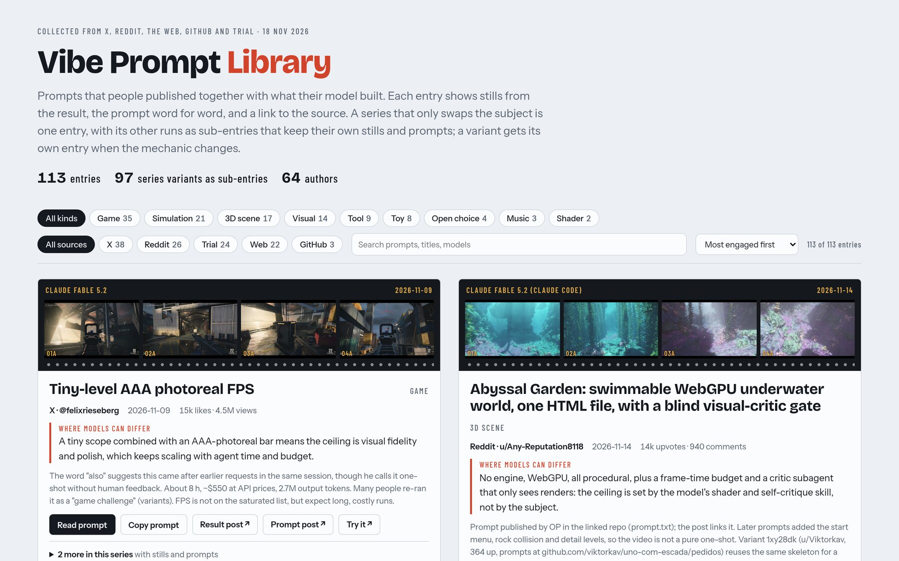
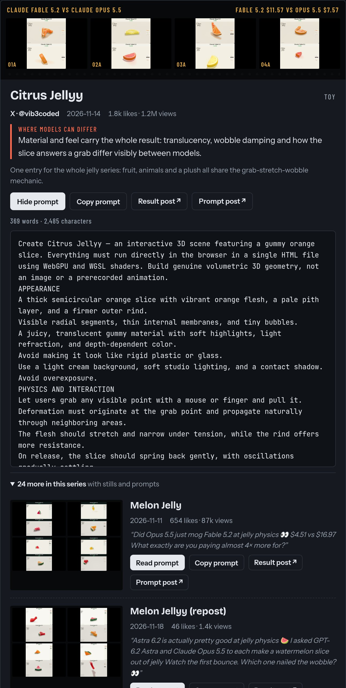

<div align="center">
  <picture>
    <source media="(prefers-color-scheme: dark)" srcset=".github/logo-dark.svg">
    <source media="(prefers-color-scheme: light)" srcset=".github/logo-light.svg">
    
  </picture>
  <h1>Vibe Prompt Library</h1>
  <p><sub>by Pyro</sub></p>
  <p>Show me what it built. Then show me the prompt.</p>
</div>

<div align="center">

[][live-url]
[![113 entries][entries-shield]][live-url]
[![Sources: X, Reddit, web, GitHub, Trial][sources-shield]](#sources-worth-following)

</div>

<div align="center">
  <a href="https://vibe-prompt-library.netlify.app/">Open the library</a> &middot;
  <a href="#why-this-exists">Why</a> &middot;
  <a href="#what-keeps-a-prompt-open">What keeps a prompt open</a> &middot;
  <a href="#sources-worth-following">Sources</a> &middot;
  <a href="#add-an-entry">Add an entry</a>
</div>

---



## Why this exists

[Trial](https://github.com/pyros-projects/Trial) compares coding models through the apps they deliver.
A few rounds in, some briefs stopped telling me anything about the models. There are only so many ways
to build a better black-hole simulator. When every model nails it, the prompt is the ceiling, not the
model.

Meanwhile people post a jelly watermelon, a pixel-art fighter jet or an octopus escaping its jar, with
the prompt right underneath. This library collects those: stills of the result, the prompt word for
word, and a link to the post. If someone shows a result and keeps the prompt to themselves, it's not in
here.

## What's in it

<table>
<tr>
<td width="42%" valign="top">

</td>
<td valign="top">

**113 entries** from X, Reddit, the web, GitHub and all 24 Trial briefs. Each has stills of what came
out, the prompt as the author published it, and links to the result and the prompt.

**Series stay together.** Someone builds the same jelly toy as an orange, a melon, a whale, an octopus
and twenty more. That's one entry. Every other run sits underneath as a sub-entry, 97 in all, each with
its own stills and prompt. If the original post disappears, the library still has both. A variant gets
its own entry when the mechanic changes: slicing the jelly, dropping it in a pool, rolling jelly dice.

**Where models can differ.** Most entries say what the prompt leaves open for a stronger model: taste,
a mechanism you can check, or a subject the model picks itself.

**Find and copy.** Filter by kind (game, simulation, toy, tool, shader, music, open choice) and by
source, search inside every prompt including the sub-entries, and copy a prompt with one click.

</td>
</tr>
</table>

## What keeps a prompt open

Prompts that leave room tend to be one of four kinds:

- **The model picks the subject.** trez63's daily contest with a no-repeats rule, Startrise's "make
  something worth making", a one-liner asking a model to show off. There is no subject to saturate.
- **A mechanism you can check.** A V8 engine with four-stroke valve timing, a cassette recorder whose keys
  latch and whose reels change size, a truss bridge solver that has to balance, an octopus that may
  turn the lid only with its tentacles. However good the screenshot, a wrong answer shows up the
  moment you check.
- **Vague on purpose, run for a long time.** One loose terrain prompt, run on 13 Claude models for
  well over a year. With no checklist to follow, the models differ in taste and ambition.
- **A classic with a real twist.** Snake, but the food hops away when you get close and the walls
  disagree about killing you. Nearly unwinnable, and none of the models noticed.

## Sources worth following

People and pages that publish the prompt with the result, again and again:

- **[Trial by Pyro](https://trial-by-pyro.netlify.app/):** 24 agentic briefs, each built by several
  models, every build playable side by side.
- **On X:** [@vib3coded](https://x.com/vib3coded) and [@semichenkko](https://x.com/semichenkko) post a
  `PROMPT` reply under almost every video.
- **Benchmark pages that freeze the prompt and run every model live:**
  [Spring Prompt](https://springprompt.com/playground), [PlanSmith](https://plansmith.io/),
  [Startrise](https://www.startrise.io/benchmark), [Mia's AI Lab](https://github.com/MiaAI-Lab),
  [AI with Britt](https://aiwithbritt.com/experiments), [games.sharvy.dev](https://games.sharvy.dev/).
- **[trez63](https://trez63.com/):** one fixed open prompt, a new app every day.

## How it was collected

- Only posts that show the result and publish the full prompt: in the post, a reply, a comment, a gist,
  a repo or a benchmark page.
- Stills are four frames from the result video, the images a page published, or a screenshot of the
  live demo. Trial entries show each model's build.
- Model names, build times and costs are the poster's own claims.
- Prompts, stills and builds belong to their authors. Every entry links to its source.

## Run it locally

The site is static. From the repo root:

```bash
uv run --no-project python -m http.server 8000 -d site
```

Then open http://localhost:8000.

## Repo layout

```text
data/library.jsonl   one entry per line: prompt, stills, links, sub-entries ("variants")
data/meta.json       collection date and the method notes shown in the page footer
src/template.html    the page; build_page.py injects the data
site/                what gets deployed: index.html and img/
tools/               build and media scripts
```

## Add an entry

1. Append a line to `data/library.jsonl` with at least `id`, `venue` (`x`, `reddit`, `web`, `github`
   or `trial`), `title`, `author`, `source_url`, `prompt`, `category` and `media`.
2. Fetch stills. Videos give four frames, images are re-encoded to 960 px:

   ```bash
   uv run --no-project python tools/fetch_media.py new.jsonl new-with-stills.jsonl site/img /tmp/stills tools/stills.sh
   ```

   For Reddit videos, run `tools/resolve_vreddit.py` first; it swaps `v.redd.it` links for a direct file.
3. Rebuild the page:

   ```bash
   uv run --no-project python tools/build_page.py data/library.jsonl data/meta.json src/template.html site/index.html
   ```

4. Deploy `site/`:

   ```bash
   netlify deploy --prod --no-build --dir site --site vibe-prompt-library
   ```

[live-url]: https://vibe-prompt-library.netlify.app/
[entries-shield]: https://img.shields.io/badge/entries-113-d2432c?style=flat-square
[sources-shield]: https://img.shields.io/badge/sources-X%20%C2%B7%20Reddit%20%C2%B7%20web%20%C2%B7%20GitHub%20%C2%B7%20Trial-15191e?style=flat-square
